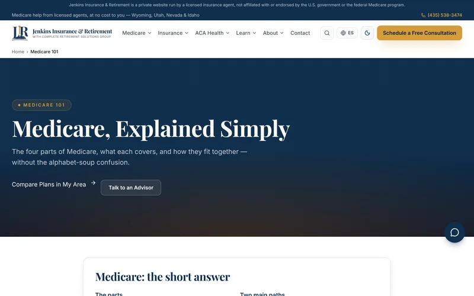
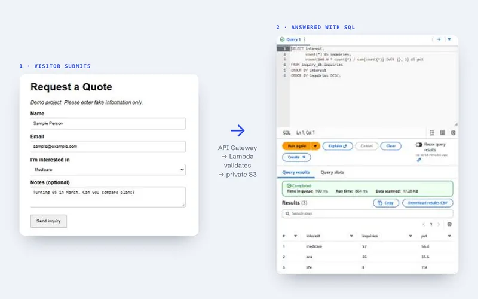
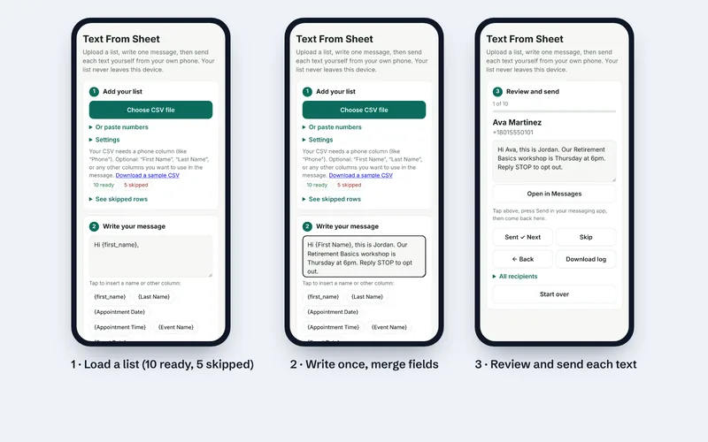
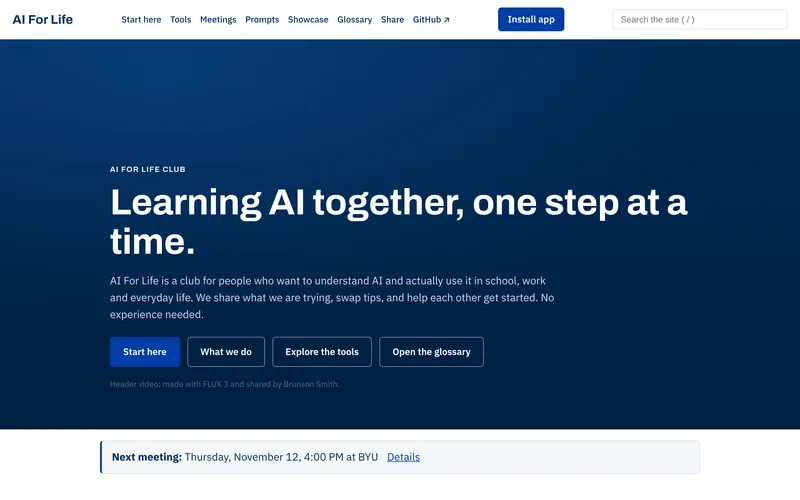

<picture>
  <source media="(prefers-color-scheme: dark)" srcset="assets/header-dark.svg">
  
</picture>

**[Portfolio](https://thej1u.github.io/portfolio/)** · **[LinkedIn](https://www.linkedin.com/in/jordan-jenkinscrsg/)** · **[Email](mailto:jordypauly01@gmail.com)**

I'm an **Information Systems student** (Applied AI emphasis) at Utah Valley University and a **licensed insurance agent** in Utah and Wyoming. I build working software for real business problems: a live bilingual Medicare website, a serverless data pipeline on AWS, and automation tools with safety rules built in. I use AI coding tools, and I own the requirements, the decisions and the testing.

**Open to internships** in information systems, data analytics and applied AI.

## Featured work

<table>
<tr>
<td width="50%" valign="top">

**[jenkinsir.com](https://thej1u.github.io/portfolio/jenkinsir.html)**, a Medicare education website 
About 1,900 pages in English and Spanish, an assistant that can't invent advice (238 answers, each tested in both languages), and nine automated checks before every release. 
React · TypeScript · TanStack Start · Vercel · <a href="https://jenkinsir.com">live site</a> · code private
</td>
<td width="50%" valign="top">

**[Client Inquiry Pipeline](https://thej1u.github.io/portfolio/#client-inquiry-pipeline)**, serverless data on AWS 
Quote requests become structured records you can query with SQL. Least-privilege access, infrastructure as code, and 12 tests run by CI on every push. Fake data only. 
AWS (S3, Lambda, API Gateway, Athena, CloudFront) · Python · SQL · SAM
</td>
</tr>
<tr>
<td width="50%" valign="top">

**[Text From Sheet](https://github.com/TheJ1u/text-from-sheet)**, safe texting from your own phone 
Built for a family member: consent and opt-out rules, sensitive-data blocking and paced sending, verified by 153 automated tests. 
Python · JavaScript · Android (Termux) · <a href="https://thej1u.github.io/text-from-sheet/web/">web app</a>
</td>
<td width="50%" valign="top">

**[AI For Life](https://github.com/TheJ1u/ai-for-life)**, a student AI club website 
I founded the site and its contribution process: tool walkthroughs with business use cases, a glossary, and pull requests from members that I review. 
HTML · CSS · JavaScript · GitHub Pages · <a href="https://thej1u.github.io/ai-for-life/">live site</a>
</td>
</tr>
</table>

Each project on my [portfolio](https://thej1u.github.io/portfolio/) includes why I built it, what I learned, and where it falls short.

## How I work

- **Start from the business problem.** Every project answers a real need from insurance, a family member, or my club.
- **AI-assisted, human-verified.** I build with Claude Code. I write the requirements, make the design and compliance calls, and prove the result with automated tests.
- **Honest about limits.** Fake data is labeled fake, and untested parts are labeled untested.

## Skills

**Used in my projects:** Python · JavaScript · TypeScript · HTML/CSS · React · TanStack Start · Tailwind CSS · AWS (S3, Lambda, API Gateway, Athena, CloudFront) · AWS SAM · GitHub Actions · Vercel · GitHub Pages · Playwright · pytest · Google Sheets and Apps Script · accessibility (WCAG) · SEO

**AI tools:** Claude Code · Lovable · rule-based assistant design · prompt and requirements writing

**Business:** licensed insurance agent (Utah, Wyoming) · Medicare and ACA · client communication · English and Spanish

**Learning now:** SQL · Git and GitHub · the Claude API

## Contact

[jordypauly01@gmail.com](mailto:jordypauly01@gmail.com) · [LinkedIn](https://www.linkedin.com/in/jordan-jenkinscrsg/) · Provo, Utah
